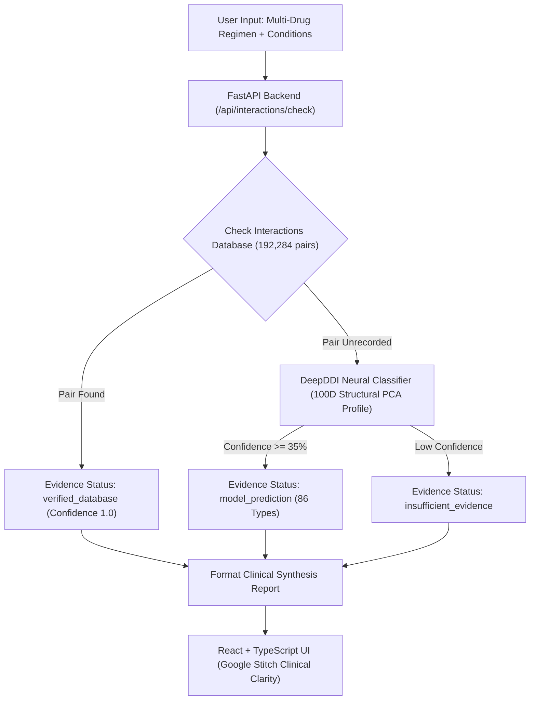

# MediGuard AI — Intelligent Drug–Drug Interaction Detection & Severity Prediction System

MediGuard AI is an enterprise-grade precision pharmacovigilance intelligence platform. It systematically detects multi-drug interaction contraindications, predicts interaction mechanisms using deep neural architectures, and screens patient-specific chronic health conditions and dietary constituents.

---

## 1. Architectural Overview

The system operates a **Dual-Path Evidence Engine**:
1. **Gold-Standard Evidence Retrieval (Primary Path):** Direct $O(1)$ query against **192,284 experimentally documented drug pairs** from the DrugBank corpus published in *PNAS (10.1073/pnas.1803294115)*.
2. **DeepDDI Neural Network Classification (Prediction Fallback):** When a candidate pair is unrecorded in the empirical database, a multi-layer deep neural network evaluates 100-dimensional structural PCA similarity profiles (50D Drug A + 50D Drug B) to classify the interaction into one of **86 pharmacological interaction types** with **85.76% Top-1** and **98.39% Top-3** benchmark accuracy.
3. **Clinical Severity Transparency:** Because the research datasets classify pharmacological interaction mechanisms rather than validated clinical severity ratings, severity tiers (Low/Moderate/High) are **never fabricated** and are explicitly reported as *Unverified / Clinical Severity Assessment Unavailable*.



---

## 2. Directory Structure

```
├── dataset/                                # Original research datasets (Read-only)
│   ├── pnas.1803294115.sd01.xlsx           # 86 DDI types & sentence templates
│   ├── pnas.1803294115.sd02.xlsx           # 192,284 gold-standard DDI pairs & official splits
│   ├── pnas.1803294115.sd03.xlsx           # Drugs.com consistency validation dataset
│   ├── pnas.1803294115.sd04.xlsx           # Alternative medication recommendations (26k pairs)
│   ├── pnas.1803294115.sd05.xlsx           # Drug-food constituent interactions (358k rows)
│   ├── pnas.1803294115.sd06.xlsx           # Disease condition & dietary warnings (4.5k rows)
│   └── pnas.1803294115.sd07.xlsx           # Food constituent bioactivity catalog
├── processed_data/                         # Generated clean datasets & database
│   ├── ddi_types.json                      # 86 interaction types & regex extractors
│   ├── drugs.json                          # 1,710 approved therapeutics catalog
│   ├── drug_features_pca50.json            # 50D PCA structural similarity vectors
│   ├── interactions.db                     # Indexed SQLite database (192,284 pairs)
│   ├── alternatives.json                   # Lower-risk therapeutic substitutions
│   ├── condition_alerts.json               # Disease & dietary contraindications
│   └── DATA_PREPARATION_SUMMARY.md         # Data preprocessing audit report
├── backend/                                # FastAPI application & ML pipeline
│   ├── app/
│   │   ├── main.py                         # FastAPI entrypoint & CORS configuration
│   │   ├── routes/                         # API route controllers (health, drugs, interactions)
│   │   ├── services/                       # Business logic (drug_service, interaction_service)
│   │   └── schemas/                        # Pydantic request/response models
│   ├── data_preparation/
│   │   ├── prepare_data.py                 # ETL script parsing SD01-SD07
│   │   └── validate_data.py                # Preprocessed data integrity validation
│   ├── ml/
│   │   ├── train.py                        # Model training on official 115k/38k splits
│   │   ├── predict.py                      # Standalone inference engine
│   │   └── models/                         # Serialized models, scalers, and evaluation reports
│   ├── tests/                              # Integration & unit test suites
│   └── requirements.txt                    # Python dependencies
├── frontend/                               # React 19 + TypeScript + Vite + Tailwind UI
│   ├── src/
│   │   ├── components/                     # Sidebar, Header, PharmacologicalSvg
│   │   ├── views/                          # Overview, Checker, Results, Medications, Conditions, History, About
│   │   ├── services/api.ts                 # Typed API client
│   │   ├── App.tsx                         # State management & routing
│   │   └── index.css                       # Google Stitch design system tokens
│   ├── package.json
│   └── tailwind.config.js                  # Clinical Clarity custom palette & typography
├── PROJECT_STATUS.md                       # Comprehensive Phase 1-6 audit & decision record
├── run_tests.py                            # Automated test runner script
└── .env.example                            # Environment variables template
```

---

## 3. Quick Start Guide (Windows Commands)

### Prerequisites
- Python 3.11 (`py -3.11`)
- Node.js v18+ & npm

### Step 1: Install Dependencies

```powershell
# Install Python backend dependencies
py -3.11 -m pip install -r backend/requirements.txt

# Install Frontend dependencies
cd frontend
npm install
cd ..
```

### Step 2: Data Preparation & Preprocessing (Already generated, repeatable at any time)

```powershell
py -3.11 backend/data_preparation/prepare_data.py
py -3.11 backend/data_preparation/validate_data.py
```

### Step 3: Train & Benchmark Machine Learning Models

```powershell
py -3.11 backend/ml/train.py
```
*Trained on 115,446 official PNAS training pairs, validated on 38,419 validation pairs, and benchmarked on 38,419 test pairs.*

### Step 4: Run the Complete Test Suite

```powershell
py -3.11 run_tests.py
```
*Validates data preprocessing integrity, ML inference, API endpoints, and production build.*

### Step 5: Start the Backend API

```powershell
py -3.11 -m uvicorn backend.app.main:app --host 127.0.0.1 --port 8000 --reload
```
*Swagger interactive documentation available at: `http://127.0.0.1:8000/docs`*

### Step 6: Start the Frontend UI

In a new terminal window:
```powershell
cd frontend
npm run dev -- --host 127.0.0.1 --port 5173
```
*Open `http://127.0.0.1:5173/` in your browser.*

---

## 4. Machine Learning Benchmark Metrics

Evaluated on the **official 38,419 test set pairs**:

| Metric | Baseline (Multinomial SGD) | DeepDDI Neural Network (MLP 256→128→86) |
| :--- | :--- | :--- |
| **Top-1 Test Accuracy** | 50.44% | **85.76%** |
| **Top-3 Test Accuracy** | 72.10% | **98.39%** |
| **Top-5 Test Accuracy** | 81.30% | **99.51%** |
| **Macro Precision** | 35.12% | **81.35%** |
| **Macro Recall** | 22.55% | **76.52%** |
| **Macro F1-Score** | 22.55% | **77.83%** |
| **Weighted F1-Score** | 50.11% | **85.74%** |
| **Training Time** | 12.03s | 82.39s |

---

---

## 5. Authentication, Profile & Personal Health Onboarding

MediGuard AI provides user data isolation and clinical profile persistence:
- **Authentication:** Bcrypt password hashing, JWT Bearer tokens with 24h expiration, and self-only authorization.
- **5-Step Onboarding Wizard:**
  - **Step 1 — Basic Information:** Full legal name, email, phone with country code, DOB with automated age calculation, optional gender & profile photo.
  - **Step 2 — Health Information:** Searchable multi-select conditions (Hypertension, Diabetes, Asthma, Dengue fever, Liver disease, CKD, etc.), allergies/hypersensitivities, and clinical notes.
  - **Step 3 — Current Medications:** Real-time drug search connected to the 1,710 DrugBank database entries, dosage, frequency, start date, and active list management.
  - **Step 4 — Emergency Contact:** Primary and optional secondary emergency contacts with relationship and international phone formatting.
  - **Step 5 — Review & Save:** Compact clinical review before saving to the encrypted SQLite database (`processed_data/user_data.db`).
- **Personalized Clinical Dashboard:**
  - Personalized greeting with first name
  - Profile completion progress indicator
  - Active regimen and condition summary cards
  - Prominent prefilled "Check Interactions" CTA (allows editing medicines before evaluation)
  - Recent interaction reports with severity chips
- **Warm Healthcare-Tech Visual Aesthetics:**
  - Warm ivory backgrounds (`#FAF7F2`)
  - Terracotta / burnt orange primary accents (`#C85A32`)
  - Muted plum (`#6E4A58`), warm beige (`#DFD5C6`), soft rose (`#F0DDD8`)
  - Charcoal-brown text (`#2D2421`) for high readability and contrast

---

## 6. API Reference

### Authentication Endpoints
- `POST /api/auth/register` — Register a new practitioner/patient account
- `POST /api/auth/login` — Sign in and obtain JWT Bearer access token
- `POST /api/auth/forgot-password` — Verified email password reset
- `GET /api/auth/me` — Retrieve current authenticated user details

### Profile & Clinical Data Endpoints (Protected: Bearer Token)
- `GET /api/profile` — Retrieve complete user profile, conditions, regimen, and emergency contacts
- `POST /api/profile/onboarding` — Multi-step onboarding batch submission
- `POST /api/profile/medications` — Add active prescription to cabinet
- `DELETE /api/profile/medications/{id}` — Delete medication from regimen
- `PUT /api/profile/conditions` — Update chronic condition flags
- `POST /api/profile/emergency-contacts` — Add emergency contact
- `DELETE /api/profile/emergency-contacts/{id}` — Delete emergency contact
- `PUT /api/profile/account` — Update profile name, phone, or password
- `DELETE /api/profile/account` — Permanent account and record deletion
- `POST /api/profile/history` — Record evaluated interaction report
- `GET /api/profile/history` — Retrieve user's previous interaction reports

### Pharmacovigilance & ML Endpoints
- `GET /api/health` — System status, loaded models, and pair count
- `GET /api/drugs/search?q={query}` — Search therapeutics by generic name, DrugBank ID, or category
- `POST /api/interactions/check` — Evaluate multi-drug combinations with condition alerts

---

## 7. Testing & Verification

Run the full automated test suite:
```powershell
# Run all 4 comprehensive test suites (Data integrity, ML inference, API routes, Frontend build)
py -3.11 run_tests.py

# Run dedicated authentication and profile access control tests (8 tests)
py -3.11 backend/tests/test_auth_profile.py

# Test frontend production build
cd frontend
npm run build
```

---

## 8. Scientific References & Disclosures

1. **Primary Research:** Ryu, J. Y., Kim, H. U., & Lee, S. Y. (2018). *Deep learning provides a systematic approach to predict drug–drug interactions*. PNAS, 115(18), E4304–E4311.
2. **Clinical Safety Notice:** MediGuard AI is designed for research, clinical decision support, and education. It does not replace the professional judgement of a licensed physician or pharmacist. Absence of an interaction record does not imply clinical safety.

